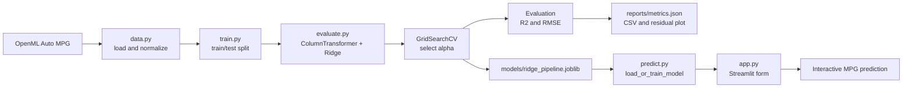

# Predictive Linear Regression Model Pipeline

[](https://github.com/Belloblaze-web3/predictive-linear-regression/actions/workflows/ci.yml)
[](https://www.python.org/)
[](https://streamlit.io/)
[](LICENSE)

A production-style supervised regression project that predicts vehicle fuel economy in miles per gallon (MPG) from technical specifications. The project uses the real **Auto MPG** dataset obtained from OpenML and demonstrates a complete machine-learning lifecycle:

- Reproducible data ingestion and schema validation
- Mean imputation for missing numeric values
- Most-frequent imputation for missing categorical values
- Standard feature scaling
- One-hot encoding for categorical data
- Regularized Ridge regression
- Cross-validated hyperparameter selection
- Leakage-safe train/test evaluation
- R² and RMSE reporting
- Persisted model and diagnostic artifacts
- Interactive Streamlit inference
- Docker and Streamlit Community Cloud deployment paths
- Automated tests and GitHub Actions CI

The public source repository is available at [github.com/Belloblaze-web3/predictive-linear-regression](https://github.com/Belloblaze-web3/predictive-linear-regression).

---

## Contents

- [Project overview](#project-overview)
- [Architecture](#architecture)
- [Dataset and feature schema](#dataset-and-feature-schema)
- [Modeling workflow](#modeling-workflow)
- [Repository layout](#repository-layout)
- [Requirements](#requirements)
- [Quick start](#quick-start)
- [Train the model](#train-the-model)
- [Inspect outputs](#inspect-outputs)
- [Run the Streamlit application](#run-the-streamlit-application)
- [Run with Docker](#run-with-docker)
- [Deploy to Streamlit Community Cloud](#deploy-to-streamlit-community-cloud)
- [Testing and quality checks](#testing-and-quality-checks)
- [Configuration](#configuration)
- [Reproducibility](#reproducibility)
- [Limitations and future improvements](#limitations-and-future-improvements)
- [Contributing and license](#contributing-and-license)

## Project overview

The application estimates MPG from a vehicle's cylinders, engine displacement, horsepower, weight, acceleration, model year, and origin. The prediction target is continuous, so this is a regression problem rather than a classification problem.

The repository has two execution modes:

1. **Batch training:** fetch the dataset, train and tune the Ridge pipeline, evaluate it on a held-out test set, and save model and reporting artifacts.
2. **Interactive inference:** load the saved pipeline in Streamlit, collect vehicle specifications through a form, and return an MPG estimate.

The app is designed to work both with a pre-trained artifact and from a clean checkout. If `models/ridge_pipeline.joblib` is not present, the app trains the configured model once from OpenML and caches it for the Streamlit process.

## Architecture



### Module responsibilities

| Component | Responsibility |
|---|---|
| `src/predictive_regression/data.py` | Downloads Auto MPG from OpenML, normalizes column names, converts types, validates required fields, and separates features from the target. |
| `src/predictive_regression/evaluate.py` | Builds the preprocessing `ColumnTransformer`, complete scikit-learn `Pipeline`, and R²/RMSE metric functions. |
| `src/predictive_regression/train.py` | Runs the end-to-end training workflow, performs cross-validation, saves artifacts, and logs evaluation results. |
| `src/predictive_regression/predict.py` | Resolves artifact paths, loads or trains the model, reads metrics, and exposes single-row inference. |
| `app.py` | Streamlit user interface for entering vehicle specifications and viewing an MPG prediction. |
| `configs/config.yaml` | Central configuration for the OpenML dataset, split, Ridge search, and artifact paths. |
| `tests/` | Unit and integration coverage for ingestion, preprocessing, training, and inference. |

## Dataset and feature schema

The loader uses scikit-learn's `fetch_openml` with dataset name `autoMpg` and version `1`. The loader normalizes the OpenML representation into the following schema:

| Feature | Type | Meaning | App input |
|---|---|---|---:|
| `cylinders` | Numeric | Number of engine cylinders | Yes |
| `displacement` | Numeric | Engine displacement | Yes |
| `horsepower` | Numeric | Engine horsepower | Yes |
| `weight` | Numeric | Vehicle weight in pounds | Yes |
| `acceleration` | Numeric | Acceleration measurement | Yes |
| `model_year` | Numeric | Model year code in the source dataset | Yes |
| `origin` | Categorical | Source-region code: USA, Europe, or Japan | Yes |
| `mpg` | Continuous target | Miles per gallon | Predicted |

The OpenML dataset is downloaded at training time, so the first run requires internet access. The application does not store the raw dataset in the repository.

## Modeling workflow

### 1. Ingestion and normalization

`load_auto_mpg()` fetches the OpenML frame, normalizes column names, converts numeric fields with coercion, converts `origin` to a string categorical value, renames the source `model` field to `model_year`, and removes rows with missing target values.

### 2. Leakage-safe preprocessing

The preprocessing is part of the fitted scikit-learn pipeline. This is important because every transformation is learned from the training split only.

- Numeric branch: `SimpleImputer(strategy="mean")` followed by `StandardScaler()`.
- Categorical branch: `SimpleImputer(strategy="most_frequent")` followed by `OneHotEncoder(handle_unknown="ignore")`.
- Unrecognized columns are dropped explicitly by the `ColumnTransformer`.

### 3. Regularized estimator

The estimator is `sklearn.linear_model.Ridge`. Ridge adds an L2 penalty to reduce coefficient instability and help control overfitting, particularly when scaled features and encoded categories are correlated.

### 4. Hyperparameter selection

`GridSearchCV` evaluates the following `regressor__alpha` values with five-fold cross-validation:

```text
0.01, 0.1, 1.0, 10.0, 100.0
```

The selection metric is `neg_root_mean_squared_error`, so the best model minimizes RMSE. After selection, the best pipeline is refit on the complete training split.

### 5. Final evaluation

The held-out test set is never used for fitting or hyperparameter selection. The final evaluation reports:

- **R²:** proportion of target variance explained by the model.
- **RMSE:** typical prediction error in MPG, with lower values being better.

## Repository layout

```text
predictive-linear-regression/
├── app.py                              # Streamlit interactive prediction UI
├── configs/
│   └── config.yaml                     # Dataset, model, and artifact settings
├── src/predictive_regression/
│   ├── __init__.py
│   ├── data.py                         # OpenML ingestion and schema normalization
│   ├── evaluate.py                     # Preprocessing, Ridge pipeline, metrics
│   ├── predict.py                      # Inference and model loading helpers
│   └── train.py                        # Training and artifact generation
├── tests/
│   ├── test_pipeline.py                # Data and training workflow tests
│   └── test_prediction.py              # Inference tests
├── models/                             # Generated model artifact; ignored by Git
├── reports/                            # Generated metrics and diagnostics; ignored
├── .github/workflows/ci.yml            # GitHub Actions test workflow
├── .streamlit/config.toml              # Streamlit runtime configuration
├── Dockerfile                          # Container image definition
├── requirements.txt                    # Runtime/training dependencies
├── requirements-streamlit.txt          # Runtime plus Streamlit
├── pyproject.toml                      # Package metadata and optional extras
├── Makefile                            # Convenience commands
├── CONTRIBUTING.md
├── CODE_OF_CONDUCT.md
├── LICENSE
└── README.md
```

## Requirements

- Python 3.10 or newer
- Internet access for the first training run, because the dataset is fetched from OpenML
- `pip` and `venv`
- Optional: Docker for container deployment

## Quick start

Create an isolated environment, install the package and development dependencies, run the tests, and train the model:

```bash
git clone https://github.com/Belloblaze-web3/predictive-linear-regression.git
cd predictive-linear-regression

python3 -m venv .venv
source .venv/bin/activate       # Windows: .venv\\Scripts\\activate
python -m pip install --upgrade pip
pip install -e '.[dev]'

pytest -q
python -m predictive_regression.train
```

The editable install makes the `predictive_regression` package importable from the command line and mirrors the setup used by CI.

## Train the model

The canonical training command is:

```bash
python -m predictive_regression.train
```

To use a different configuration file:

```bash
python -m predictive_regression.train --config configs/config.yaml
```

The command logs metrics and writes the configured artifacts. A successful run ends with output similar to:

```text
Test R²: 0.8448 | Test RMSE: 2.8882 mpg | Best alpha: 1.0
```

The exact values can change if the OpenML dataset is updated or its parser behavior changes. Treat the generated `reports/metrics.json` as the authoritative result for the current run.

You can also use the Makefile:

```bash
make install
make test
make train
```

## Inspect outputs

Training creates the following files:

| Artifact | Description |
|---|---|
| `models/ridge_pipeline.joblib` | Serialized preprocessing and Ridge estimator pipeline used for inference. |
| `reports/metrics.json` | Dataset summary, split information, selected alpha, and held-out R²/RMSE. |
| `reports/predictions.csv` | Held-out actual values, predictions, and residuals. |
| `reports/residuals.png` | Residual diagnostic plot. |

Generated models and reports are intentionally ignored by Git. They can always be recreated with the training command and are not required in source control for the app to operate.

## Run the Streamlit application

Install the application extra:

```bash
pip install -e '.[app]'
```

If you have not trained locally, the app will train automatically on first startup. To launch it:

```bash
streamlit run app.py
```

Open the local URL printed by Streamlit, normally `http://localhost:8501`.

The interface provides inputs for:

- Cylinders
- Displacement
- Horsepower
- Weight
- Acceleration
- Model year
- Origin

Select **Predict fuel economy** to receive the estimated MPG. The sidebar displays the held-out R², held-out RMSE, and selected Ridge alpha when `reports/metrics.json` is available.

### Inference behavior

`app.py` calls the cached `get_model_and_metrics()` function. The inference service then:

1. Resolves the configured model and metrics paths.
2. Loads `models/ridge_pipeline.joblib` if it exists.
3. Trains the configured pipeline if the model artifact is missing.
4. Loads the metrics report if available.
5. Applies the exact same preprocessing pipeline to the submitted feature row.
6. Returns a single floating-point MPG estimate.

Caching prevents retraining or reloading the model on every Streamlit interaction.

## Run with Docker

Build the image from the repository root:

```bash
docker build -t auto-mpg-predictor .
```

Run the application:

```bash
docker run --rm -p 8501:8501 auto-mpg-predictor
```

Open `http://localhost:8501` in a browser. The image installs `requirements-streamlit.txt`, which includes the core requirements and Streamlit. The container intentionally excludes local model and report artifacts; if they are not copied into the image, the app trains from OpenML during its first startup.

## Deploy to Streamlit Community Cloud

1. Push the repository to GitHub.
2. Open [Streamlit Community Cloud](https://share.streamlit.io/).
3. Create a new app from `Belloblaze-web3/predictive-linear-regression`.
4. Select the `main` branch.
5. Set the main file to `app.py`.
6. Use `requirements-streamlit.txt` as the dependency file if the platform requests one.
7. Deploy.

The deployed environment must be able to reach OpenML if the model artifact is not included. The first startup can therefore take longer than subsequent interactions while the dataset is downloaded and the model is trained.

For a production deployment, consider prebuilding and versioning the model artifact or moving training into a separate scheduled job so web-serving startup does not depend on external dataset availability.

## Testing and quality checks

Run all tests:

```bash
pytest -q
```

Run the same checks used locally by the project workflow:

```bash
python -m py_compile app.py src/predictive_regression/*.py
pytest -q
```

The tests cover:

- Dataset loading and expected schema
- Numeric and categorical preprocessing
- Pipeline construction
- End-to-end training behavior
- Single-row prediction returning a valid scalar

GitHub Actions runs the automated test suite on pushes and pull requests. Keep tests deterministic and avoid committing downloaded data, model binaries, secrets, or local environment files.

## Configuration

All primary settings are in [`configs/config.yaml`](configs/config.yaml):

```yaml
data:
  openml_name: autoMpg
  openml_version: 1
  target: mpg
  test_size: 0.2
  random_state: 42

model:
  cv_folds: 5
  scoring: neg_root_mean_squared_error
  ridge_alphas: [0.01, 0.1, 1.0, 10.0, 100.0]
```

The `artifacts` section controls the output paths. Relative paths are interpreted from the project root. To change the target or feature set, update the loader and preprocessing feature lists together, then extend the tests and app form as appropriate.

## Reproducibility

The project fixes the train/test split seed at `42` and uses a deterministic cross-validation configuration. Reproducibility still depends on the following external factors:

- The current contents and metadata of the OpenML dataset
- Python and dependency versions
- scikit-learn parser and serialization behavior
- Availability of OpenML during training

For a stronger audit trail, record the generated `reports/metrics.json`, the dependency lock state, the OpenML dataset version, and the selected model artifact together.

## Latest validated run

The previously validated configuration produced the following benchmark:

| Metric | Value |
|---|---:|
| Test R² | 0.8448 |
| Test RMSE | 2.8882 MPG |
| Selected alpha | 1.0 |

These values are reference results, not a guarantee for every future OpenML download. Always use the latest generated `reports/metrics.json` for the current run.

## Limitations and future improvements

This project is intentionally focused on a clear, maintainable baseline. Potential next steps include:

- Add data versioning and dataset checksums.
- Pin dependencies with a lockfile for stricter reproducibility.
- Add model drift and input-distribution monitoring.
- Add prediction intervals or uncertainty estimates.
- Add experiment tracking and a model registry.
- Separate training from serving in deployment infrastructure.
- Add authentication and request logging for public production serving.
- Add a schema contract for API and UI inputs.
- Compare Ridge against Elastic Net, Random Forest, and gradient-boosting baselines.
- Add automated model-quality gates to CI.

## Contributing and license

Contributions are welcome. Please read [`CONTRIBUTING.md`](CONTRIBUTING.md) before opening a pull request and follow the standards in [`CODE_OF_CONDUCT.md`](CODE_OF_CONDUCT.md).

This project is released under the [MIT License](LICENSE).
